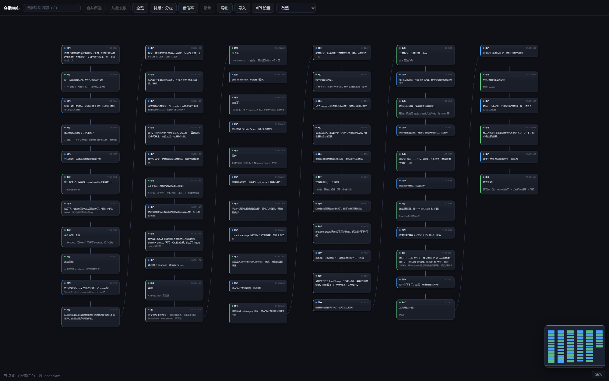

# convo-canvas

**Turn any AI chat session into an interactive, editable canvas.**
Every message becomes a card on a zoomable map — merge the turns that matter into one clean context, branch a new thread with your own LLM, and rearrange the whole conversation as a column, a snake, or a **tree**.

A single-file HTML output. No server, no telemetry, works offline.

> 把任意 AI 会话变成可操作的无限画布：每段对话是一张卡片，框选 → 合并成精选上下文 → 注入你自己的模型（流式）→ 从任意节点发散。支持纵列 / 分栏 / 树形三种排版，产物是零依赖单文件 HTML，双击即开。


*A staged planning conversation on the canvas — snake columns at semantic zoom; the minimap (bottom-right) shows the full map with the live viewport box.*

Try it without generating anything: open [`docs/demo.html`](docs/demo.html) in a browser (or enable GitHub Pages and use `/docs`). Everything in that file is a fabricated demo conversation, not real data.

---

## What problem this solves

Long AI sessions hit the context window. The usual workarounds are bad:

- scroll a 300-message thread and copy-paste fragments by hand
- start a fresh chat and lose everything the model already learned
- export to Markdown and lose the structure of *who answered what, where*

convo-canvas turns the whole session into something you can **operate on**: see it all at once, select the turns that actually matter, collapse them into one curated context, and continue from there.

You pay tokens for the essence, not hundreds of rounds of history noise.

**If you have ever typed any of these into a search box, this repo is the answer:**

- "visualize my Claude / ChatGPT / DeepSeek chat history as a graph"
- "chat session → canvas / mind map / node graph"
- "how to manage context windows in long AI coding sessions"
- "MCP server that exports chat sessions to HTML"
- "OpenClaw session viewer" / "DeepSeek Harness session viewer"
- "tool to compare several answers side by side and merge them"
- "offline, local-only chat history browser"

---

## Quick start

```bash
git clone https://github.com/YCk11-a/session-canvas-.git
cd convo-canvas
node bin/cli.js                 # latest session → ~/convo-canvases/*.html
node bin/cli.js <sessionId>     # a specific session (id or prefix)
node bin/cli.js latest --source dsh        # force DeepSeek Harness
node bin/cli.js latest --source openclaw   # force OpenClaw
node bin/cli.js latest -o out.html
```

Requires **Node ≥ 22.15** (native `zstd` for DeepSeek Harness sessions). The CLI itself has zero dependencies — `npm install` is only needed for the MCP server.

Open the produced HTML in any browser. To use merge/branch, open **⚙ API 设置** and point it at any OpenAI-compatible endpoint (e.g. DeepSeek: base `https://api.deepseek.com/v1`, model `deepseek-chat`). Keys stay in your browser's `localStorage` and are never written into exported files.

---

## 中文速览

- **是什么**：把 OpenClaw / DeepSeek Harness 的会话文件导出成一张可编辑的无限画布（单文件 HTML，离线可用）
- **怎么用**：`node bin/cli.js` 出画布 → 框选需要保留的几轮 → 合并成精选上下文 → 配置任意 OpenAI 兼容模型继续发散
- **能改什么**：拖拽摆位、Shift 拖卡片连线、纵列 / 分栏 / 树形三种排版，改动按会话保存
- **适合谁**：长期和 AI 写代码、讨论方案，会话经常撞上下文上限的人；想把历史会话整理成可复用材料的人
- **不做什么**：不联网、不上传、不建账号；只导出你自己机器上的会话文件

---

## Supported session sources

| Source | Path | Format |
|---|---|---|
| **OpenClaw** | `~/.openclaw/agents/main/sessions` → `~/.kimi_openclaw/agents/main/sessions` | `.jsonl`, one `message` record per turn, native `id` / `parentId` chains |
| **DeepSeek Harness** | `~/.dsh/sessions/**/session.v4.jsonl.zstd` | zstd-compressed jsonl, `user/message` + `assistant/message` |

Override with `--sessions-dir`, `OPENCLAW_SESSIONS`, or `DSH_SESSIONS`.

**Adapter-friendly:** the OpenClaw parser is just "a `.jsonl` file of `{type:"message", id, parentId, message:{role, content:[{type:"text", text}]}}`". Any tool that can emit that shape (your own agent, a scraper, an export script) works with `--sessions-dir` — no fork needed.

---

## Features

- **Three layouts, one keystroke**
  - **Column** — vertical thread, easiest to read top-to-bottom
  - **Snake** — columns that fit an entire conversation on one screen
  - **Tree** — forks spread sideways, each subtree centered: the natural view for branching sessions
- **Manual links** — `Shift`+drag one card onto another to rewire the thread (cycle-safe). Sketch your own structure, then read it back in tree layout.
- **Marquee select** (`Shift`+drag empty space) → **Merge** the selection into one curated context
- **Branch** from any node and keep talking, with any OpenAI-compatible model, streamed in-page
- **Semantic zoom** — full cards → 3-line previews → single-line strips, auto re-layout
- **Minimap** with role-colored blocks and a live viewport box
- **Search** (`/`) with hit cycling; **hover path highlight** (root → here)
- **Focus mode** (`F`) — show only the path to the selected card
- **Zoom lock** — turn the wheel into smooth panning
- **Clean exports** — tool-call rounds and system noise filtered; envelope headers and emoji stripped
- **Single-file output** — zero deps, `file://`, offline

### Keyboard

| Key | Action |
|---|---|
| `/` | focus search |
| `1` | fit all |
| `F` | focus selected node's path |
| `+` / `-` | zoom |
| `Shift`+drag | marquee (empty space) / link (from a card) |
| `Esc` | dismiss (modal → search → focus) |

---

## MCP server (Claude Desktop / Cherry Studio / Cursor / DeepSeek Harness)

Run over stdio, so the model driving the conversation can list sessions and generate canvases on request:

```json
{
  "mcpServers": {
    "convo-canvas": {
      "command": "node",
      "args": ["<path-to-convo-canvas>/bin/mcp.js"]
    }
  }
}
```

On Windows use forward slashes or escaped backslashes, e.g. `"C:/tools/convo-canvas/bin/mcp.js"`.

| Tool | What it does |
|---|---|
| `list_sessions` | recent sessions from both sources, with `source` filter |
| `generate_canvas` | export a session (`session_id`, `source`) → local viewer link + HTML path; auto-starts the viewer (port-walks if busy) |
| `canvas_status` | viewer state, URL, generated canvases |

Example: *"把刚才这个会话生成画布"* → the model calls `generate_canvas` → you click the returned link.

Env: `OPENCLAW_SESSIONS`, `CONVO_CANVAS_OUT` (default `~/convo-canvases`), `CONVO_CANVAS_PORT` (default 8791).

---

## How it compares

|  | convo-canvas | canvas-chat | Obsidian Canvas | chat-export HTML viewers | Built-in chat UIs |
|---|---|---|---|---|---|
| Imports **existing** agent sessions | ✅ OpenClaw + DSH | ❌ starts from scratch | ❌ manual cards | ⚠️ read-only dumps | — |
| Branching / merge with an LLM | ✅ | ✅ | ❌ | ❌ | ⚠️ linear only |
| Whole-session overview | ✅ minimap + semantic zoom | ✅ | ✅ (manual) | ❌ | ❌ |
| Tree layout for forks | ✅ | ❌ | ⚠️ manual | ❌ | ❌ |
| Works offline / no account | ✅ | ✅ | ✅ | ✅ | ❌ |
| Single-file artifact you can email | ✅ | ❌ | ❌ | ✅ | ❌ |

Related work: [ericmjl/canvas-chat](https://github.com/ericmjl/canvas-chat) (visual non-linear chat, cannot import existing sessions), Prompt-Tree, Mosaic, open-canvas — none of them reads native agent session histories (`id`/`parentId` chains, zstd-compressed DSH sessions).

*A machine-readable summary for AI assistants and crawlers lives in [`llms.txt`](llms.txt).*

---

## How it works

1. Parse the session file (`message` records carry native `id`/`parentId` — branching comes for free)
2. Drop tool-call rounds and system notifications (process, not product); strip envelopes and emoji
3. Re-link broken chains by walking `parentId` to the nearest kept ancestor, with a time-order fallback
4. Inject nodes + metadata into a self-contained HTML template (`__META__` / `__NODES__`)

Layout, selection, merges, manual links and generated branches are all persisted per-session in `localStorage` and can be exported/imported as JSON.

---

## FAQ

**Q: Does it upload my chats anywhere?**
No. Everything runs locally; the only network calls are the LLM requests you configure yourself. No telemetry.

**Q: Which models work for merge/branch?**
Any OpenAI-compatible `/chat/completions` endpoint with SSE streaming — DeepSeek, OpenAI, Anthropic-compatible relays, local vLLM/Ollama gateways.

**Q: How large a session can it open?**
Hundreds of turns comfortably (a 341-message session renders at 33% zoom on a 1680×1050 screen). It's a static HTML file, so the limit is browser DOM, not a server.

**Q: Can I edit the graph by hand?**
Yes — drag cards to reposition, `Shift`+drag card→card to rewire. Your layout and links are saved per session and survive reloads.

**Q: Does it work on Windows / macOS / Linux?**
Yes, anywhere Node ≥ 22.15 runs. Paths are auto-detected per platform.

**Q: Can I use it with tools it doesn't support yet?**
If you can emit OpenClaw-style `.jsonl`, point `--sessions-dir` at it. The parser is ~50 lines and easy to adapt.

---

## Privacy

- No telemetry, no network calls except the LLM requests you configure in the page
- The MCP viewer HTTP server binds to `127.0.0.1` only — never exposed on your LAN
- API keys live only in your browser's `localStorage`; exported JSON never contains them
- The generated HTML works offline, over `file://`

## License

MIT

---

<sub>Topics / search terms this project answers: conversation canvas · chat history visualizer · session viewer · context engineering · context window management · MCP server · infinite canvas · node graph · mind map · tree layout · OpenClaw · DeepSeek Harness · Claude Desktop · Cherry Studio · Cursor · local-first · offline · single-file HTML · LLM · agent sessions · branch and merge</sub>
